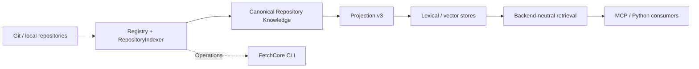

# FetchCore

<p align="center"><a href="README.md">English</a> · <a href="README.pt-BR.md">Português (Brasil)</a></p>

<p align="center">
  <picture>
    <source media="(prefers-color-scheme: dark)" srcset="assets/brand/lockup-horizontal-inverse.svg">
    
  </picture>
</p>
<p align="center">Backend-neutral repository knowledge and retrieval for developer tools, MCP clients, and coding agents.</p>

<p align="center">
  <a href="pyproject.toml"></a>
  <a href="docs/release-policy.md"></a>
  <a href="docs/guides/mcp.md"></a>
  <a href="docs/architecture/overview.md"></a>
</p>

<p align="center">
  <a href="#quick-start">Quick start</a> ·
  <a href="#how-it-works">Architecture</a> ·
  <a href="docs/README.md">Documentation</a> ·
  <a href="docs/benchmarks/baseline-v1.md">Benchmarks</a>
</p>

---

FetchCore turns source repositories into **searchable, typed, traceable technical evidence**. It acquires and indexes repository knowledge, preserves source identity and provenance, and retrieves candidates through stable, backend-neutral contracts.

**One repository knowledge boundary. Multiple retrieval backends. Any consumer.**

## Why FetchCore?

| | What it means |
| --- | --- |
| **Evidence, not guesses** | Results carry source identity and provenance so consumers can inspect where technical context came from. |
| **Canonical first** | Repository Knowledge is independent of the index; lexical and vector stores are rebuildable projections. |
| **Retrieval without lock-in** | Backend adapters and capabilities keep the application contract separate from Solr, OpenSearch, Qdrant and local implementations. |
| **Measurable changes** | Frozen benchmark inputs and retrieval telemetry make quality and efficiency changes testable. |
| **Headless by design** | CLI supports repository/index operations; MCP and Python application services expose retrieval to tools. |

## How it works



**Repository knowledge is canonical; search, vector and future graph indexes are replaceable projections.** Backend scores describe candidate ranking, not semantic authority.

> **retrieval ≠ satisfaction ≠ authority**  
> FetchCore acquires evidence. Consumers decide whether it satisfies their task and what to do with it.

## Quick start

Requires **Python 3.11+**. From a checkout of this repository:

```bash
python -m pip install -e ".[dev]"
fetchcore --help
fetchcore repo add .
fetchcore repo list
```

Registration does **not** index the repository. It safely records a canonical repository source. To index it, see the [repository indexing lifecycle](docs/guides/repository-indexing.md) and the [self-hosted indexing guide](docs/guides/self-hosted-indexing.md).

### Serve retrieval over MCP

Install the optional transport:

```bash
python -m pip install -e ".[mcp]"

export FETCHCORE_WORKSPACE="$PWD"
export FETCHCORE_REPOSITORY="owner/repository"
export FETCHCORE_BACKEND="local-semantic"

fetchcore-mcp
```

The server uses **stdio**, exposes `search` and `get_source`, and must be configured for an authorized repository. Retrieval depends on the configured source/index and backend capabilities; starting the server alone does not create an index.

See [MCP serving](docs/guides/mcp.md), [runtime configuration](docs/guides/runtime-configuration.md), and [searching](docs/guides/searching.md).

## What's available

| Surface | Current capability |
| --- | --- |
| **Repository sources** | Local workspaces and Git acquisition, canonical registry and safe scanning |
| **Knowledge** | Typed evidence, repository/revision/source identity, symbols and relationships |
| **Indexing** | Projection v3, incremental indexing, Solr-oriented operational CLI |
| **Retrieval** | Lexical, dense and hybrid paths according to backend capabilities; explicit SearchIntent semantics and supported targeted lookups |
| **Adapters** | Local semantic, Solr, OpenSearch and Qdrant vector |
| **Consumers** | Repository/index CLI, MCP `search` and `get_source`, Python application service |
| **Evaluation** | Frozen retrieval baseline and recorded telemetry |

Features such as **federated multi-repository retrieval, optional graph expansion, and graph-backed symbol navigation** remain future work. FetchCore does **not** implement agent planning, task workflows, approvals or execution authority.

## Explore the project

- [Getting started](docs/guides/getting-started.md) — install, configure and run the supported development paths.
- [Architecture](docs/architecture/overview.md) — canonical knowledge, projections and component boundaries.
- [Contracts and capabilities](docs/reference/contracts.md) — the typed API surface and backend negotiation model.
- [MCP integration](docs/guides/mcp.md) — connect a consumer and retrieve bounded source evidence.
- [Benchmarks](docs/benchmarks/baseline-v1.md) — reproduce the existing baseline instead of relying on unverified performance claims.
- [Release policy](docs/release-policy.md) — technical preview, initial bootstrap and versioning rules.
- [Documentation index](docs/README.md) — guides, references, ADRs, migrations and historical extraction records.
- [Visual identity](assets/brand/README.md) — SVG marks, GitHub avatar, palette, accessibility and asset provenance.

## Project status

FetchCore is at `0.1.0.dev0`. It is in **technical preview**: APIs and capabilities may evolve before the first tagged release. The release process will align the declared version with the approved tag; no performance superiority or universal backend compatibility is implied.

**Built for reusable repository evidence — not another agent framework.**
