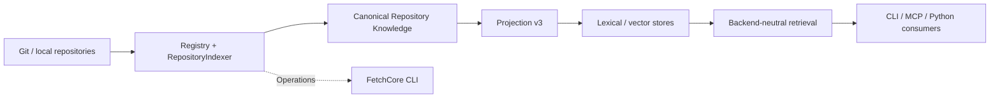

# FetchCore

<p align="center"><a href="README.md">English</a> · <a href="README.pt-BR.md">Português (Brasil)</a></p>

<p align="center">
  <picture>
    <source media="(prefers-color-scheme: dark)" srcset="assets/brand/lockup-horizontal-inverse.svg">
    
  </picture>
</p>
<p align="center">Backend-neutral repository knowledge and retrieval for developer tools, MCP clients, and coding agents.</p>

<p align="center">
  <a href="pyproject.toml"></a>
  <a href="docs/release-policy.md"></a>
  <a href="docs/guides/mcp.md"></a>
  <a href="docs/architecture/overview.md"></a>
</p>

<p align="center">
  <a href="#quick-start">Quick start</a> ·
  <a href="#how-it-works">Architecture</a> ·
  <a href="docs/README.md">Documentation</a> ·
  <a href="docs/benchmarks/baseline-v1.md">Benchmarks</a>
</p>

---

FetchCore turns source repositories into **searchable, typed, traceable technical evidence**. It acquires and indexes repository knowledge, preserves source identity and provenance, and retrieves candidates through stable, backend-neutral contracts.

**One repository knowledge boundary. Multiple retrieval backends. Any consumer.**

## Why FetchCore?

| | What it means |
| --- | --- |
| **Evidence, not guesses** | Results carry source identity and provenance so consumers can inspect where technical context came from. |
| **Canonical first** | Repository Knowledge is independent of the index; lexical and vector stores are rebuildable projections. |
| **Retrieval without lock-in** | Backend adapters and capabilities keep the application contract separate from Solr, OpenSearch, Qdrant and local implementations. |
| **Measurable changes** | Frozen benchmark inputs and retrieval telemetry make quality and efficiency changes testable. |
| **Headless by design** | CLI exposes repository registration, explicit indexing, scoped `search`/`source` and diagnostics; MCP and Python services serve retrieval to tools. |

## How it works



**Repository knowledge is canonical; search, vector and future graph indexes are replaceable projections.** Backend scores describe candidate ranking, not semantic authority.

> **retrieval ≠ satisfaction ≠ authority**  
> FetchCore acquires evidence. Consumers decide whether it satisfies their task and what to do with it.

## What FetchCore is — and is not

FetchCore is **repository knowledge and retrieval infrastructure**. It registers repository sources, acquires canonical typed knowledge with repository/revision provenance, maintains rebuildable retrieval projections, and returns bounded evidence candidates.

It is **not** an agent framework, a task planner, an artifact-approval system or an execution authority. Backend relevance scores are ranking signals, not the truth of the consumer's task.

## Quick start

Prerequisites: **CPython 3.11–3.15** and **Git**. From a fresh checkout, the following registration commands need neither Docker nor an embedding provider:

```bash
git clone https://github.com/oalangomes/fetchcore.git
cd fetchcore
python -m pip install -e ".[dev]"
fetchcore --help
fetchcore repo add . --json
fetchcore repo list --json
```

This is a **working first step**, not a retrieval demo. `repo add` stores a canonical identity in the operator registry and `repo list` reports it. Registration **does not scan, index, embed or serve** the source. Local paths are restricted to explicitly allowed roots (by default, the current directory). See [repository registration](docs/guides/repository-registry.md).

### Index, then retrieve (explicit prerequisites)

The operational indexing CLI currently targets **Solr**. First [provision and validate the backend](docs/guides/self-hosted-indexing.md), configure the [operator runtime](docs/guides/runtime-configuration.md), and use the [repository indexing lifecycle](docs/guides/repository-indexing.md) to plan and explicitly rebuild the first snapshot. Registered `index sync <repo>` needs an existing compatible snapshot and never silently rebuilds it.

**Only after** those prerequisites are satisfied, these commands illustrate the repository-targeted path:

```bash
fetchcore index plan fetchcore --json
fetchcore index rebuild fetchcore --json
fetchcore index status fetchcore --json
fetchcore search "RepositoryIndexer" --repo fetchcore --limit 5 --json
```

The repository leaf `fetchcore` is an example; substitute the canonical identity returned by `repo list` if different. **The commands above require a compatible provisioned index and runtime configuration**; a fresh registration alone is insufficient. CLI `search` exists and requires `--repo`, rather than a global unscoped search. Use `fetchcore source --help` with an actual returned `source_ref` to retrieve bounded lines. Neither retrieval command mutates the index.

For an optional local UI, [start the shared DEV service and Search Lab](docs/guides/getting-started.md#shared-developer-infrastructure-and-search-lab), then invoke indexing explicitly. **Healthy service ≠ indexed repository ≠ usable retrieval.** The [readiness check](docs/guides/runtime-configuration.md#operational-readiness-issue-134) observes repository binding, compatible snapshot and selected retrieval mode separately.

### Serve retrieval over MCP (optional)

The MCP stdio server exposes `search` and `get_source` for a configured, authorized repository. Server startup does **not** register, index or make an absent snapshot searchable.

```bash
python -m pip install -e ".[mcp]"
export FETCHCORE_WORKSPACE="$PWD"
export FETCHCORE_REPOSITORY="oalangomes/fetchcore"
export FETCHCORE_BACKEND="local-semantic"
fetchcore-mcp
```

Change the repository identity to the source you are authorized to serve. Connect an MCP client to the **stdio** process; useful results require a compatible populated source/index. If you use a Solr snapshot, select Solr and its settings through the [runtime configuration](docs/guides/runtime-configuration.md), not the local-semantic example. See [MCP serving](docs/guides/mcp.md) and [searching](docs/guides/searching.md).

## Current vs planned

| Area | Availability | Product boundary |
| --- | --- | --- |
| Repository registry | **Current** | Local/Git registration, materialization, safe roots; no implicit indexing |
| Canonical knowledge | **Current** | Typed evidence, source/revision provenance, symbols and relations |
| Indexing | **Current (Solr operational CLI)** | Projection v3, explicit initial rebuild, compatible incremental sync |
| Retrieval | **Current, capability-dependent** | Lexical, dense and hybrid require a compatible backend and indexed/embedding state |
| CLI | **Current** | `repo`, `index`, scoped `search`/`source`, `config`, `doctor`, `readiness`, `capabilities` |
| MCP stdio | **Current** | `search` and `get_source` with an authorized repository binding |
| Dedicated symbol tools | **Planned** | `find_symbol`, `get_related`; extracted relations are not the same as dedicated tools |
| Federated multi-repository retrieval | **Planned** | Bounded routing and cross-repo fusion rather than implicit concatenation |
| Graph expansion | **Planned, optional** | Bounded navigation from strong seeds; not a mandatory retrieval path |

Backend indexes are rebuildable projections, not semantic authorities. **retrieval ≠ satisfaction ≠ authority**. The consumer retains task satisfaction, approvals and execution decisions.

## Explore the project

- [Getting started](docs/guides/getting-started.md) — install, configure and run the supported development paths.
- [Developer Local installation contract](docs/guides/developer-local.md) — isolated installation, explicit indexing and first evidence sequence.
- [Architecture](docs/architecture/overview.md) — canonical knowledge, projections and component boundaries.
- [Contracts and capabilities](docs/reference/contracts.md) — the typed API surface and backend negotiation model.
- [MCP integration](docs/guides/mcp.md) — connect a consumer and retrieve bounded source evidence.
- [Benchmarks](docs/benchmarks/baseline-v1.md) — reproduce the existing baseline instead of relying on unverified performance claims.
- [Release policy](docs/release-policy.md) — technical preview, initial bootstrap and versioning rules.
- [Documentation index](docs/README.md) — guides, references, ADRs, migrations and historical extraction records.
- [Visual identity](assets/brand/README.md) — SVG marks, GitHub avatar, palette, accessibility and asset provenance.
- [MIT license](LICENSE) · [Contributing](CONTRIBUTING.md) · [Security reporting](SECURITY.md) — reuse, contributions and responsible disclosure.

## Project status

FetchCore is at `0.1.0.dev0`. It is in **technical preview**: APIs and capabilities may evolve before the first tagged release. The release process will align the declared version with the approved tag; no performance superiority or universal backend compatibility is implied.

**Built for reusable repository evidence — not another agent framework.**
