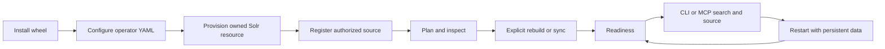

# P0.0 installation contract audit — 2026-10-19

## Identification

Phase: P0.0. Baseline `master` SHA: `7bf1c184647626132399efefd4c0740a5319265f`. Work branch: `codex/p00-installation-contract`. Issues: #200, #99, #98, #132, #133, #136, #130, #202, #203; #109 is a composition reference. #181 is closed with a scoped functional acceptance and remains separate. The host is Linux, Python 3.12.3, Docker Desktop 29.8.2, 8 logical CPUs and 19 GiB RAM. Existing `fetchcore-shared`, `fetchcore-operational` and `fetchcore-lab` stacks are running from another worktree and were **not** modified. The open benchmark PR #208 is separate from this audit.

The following is an initial HEAD inventory, not a claim that an installed first-use journey or all backend modes passed. `PROVEN` means source plus a relevant current contract test or direct read-only observation; `IMPLEMENTED_NOT_VALIDATED` means the code path exists without this phase's end-to-end proof. `BLOCKED` applies to external operational checks without an authorized isolated target.

| Capability | Existing | Validated at this gate | Gap | Issue |
| --- | --- | --- | --- | --- |
| Python distribution | **IMPLEMENTED_NOT_VALIDATED**: `pyproject.toml` declares wheel/sdist and two scripts | Build/installed smoke pending | Installed artifact behavior | #133, #136 |
| Local installation | **IMPLEMENTED_NOT_VALIDATED**: editable contributor path and container image | Clean wheel journey pending | Checkout-free Solr configset/provisioning | #200 |
| Configuration | **PROVEN**: YAML v1 loader, precedence, `config show` and contract tests | Contract surface inspected | One recommended example and first-use proof | #200 |
| Persistence | **IMPLEMENTED_NOT_VALIDATED**: registry JSON, Git mirror, backend snapshots/volumes | Code and storage contract inspected | Restart proof in isolated target | #200, #132 |
| Registry | **PROVEN**: `repo add/list/inspect`, allowed roots, atomic registry and contract tests | Code and tests present | Fresh-install proof | #200 |
| Explicit indexing | **PROVEN**: `plan`, `rebuild`, `sync`, `status` application path | Code and tests present | Operational first index proof | #200 |
| Incremental | **IMPLEMENTED_NOT_VALIDATED**: delta/no-op contracts in adapters | No isolated live run in this gate | Add/update/delete/no-op evidence | #200, #130, #202, #203 |
| CLI retrieval | **PROVEN**: registered `search/source` application path and contract tests | Code and tests present | Search/source on fresh indexed resource | #99, #98 |
| MCP serving | **PROVEN**: stdio `search/get_source` application adapter and tests | Code and tests present | Same binding and real client journey | #200 |
| Backend readiness | **PROVEN**: `doctor`, `capabilities`, `readiness` observations | Code and tests present | Live snapshot check for local profile | #132, #130, #202, #203 |
| Vector operation | **BLOCKED**: adapter paths and prior scoped reports exist | No authorized isolated live vector run here | Backend-specific operational acceptance | #130, #202, #203 |

The `self-hosted-indexing.md` narrative still describes older OpenSearch/Qdrant behavior, while `repository-indexing.md` describes the current registered operational lifecycle. The latter and the code are the current source for this contract. P0.1 must resolve misleading first-run text after a real run. No historical BENCH or #181 result is counted as this gate's live evidence.

## Contract and responsibility matrix

The recommended path and safe YAML live in [Developer Local](../guides/developer-local.md) and [ADR-0005](../adr/ADR-0005-developer-local-installation.md). Installation uses a built wheel in a venv; Docker is optional infrastructure. Solr lexical is the first persistent target; Ollama is optional. One operator YAML configures the runtime; the existing registry authorizes CLI sources, while MCP binds one explicit repository/workspace. Manual update is the initial cadence.

| Stage | Owner and interface | May read | May write/modify |
| --- | --- | --- | --- |
| Installation | Python package manager, wheel/sdist | Artifact and dependencies | Isolated environment only |
| Provisioning | Operator, Solr runtime/Compose | Service/schema/resource state | Only an authorized dedicated service/resource and durable volume |
| Onboarding | `repo add` and source provider | Authorized source/Git remote | `registry.json`, Git mirror/cache; never an index |
| Planning | `index plan/status`, `doctor/readiness` | Config, source, snapshot, backend probes | No persistent index/registry change; Git plan may create and remove a temporary worktree |
| Indexing | Explicit `index rebuild/sync` | Canonical source and prior snapshot | Owned projection, snapshot and backend resource; `sync` requires compatibility |
| Serving | CLI `search/source`, MCP `search/get_source` | Bound source and compatible projection | No registration, rebuild or snapshot write |
| Maintenance | Operator inspection and explicit migration/rebuild | Fingerprints, schema, state, backups | Only selected owned resource after separate decision |

## P0.1 acceptance and clean-environment protocol

1. Freeze a small controlled Git fixture at a commit and use a new venv, registry directory, YAML and isolated Solr resource. Record Python/package SHA, backend image/digest, host limits, allowed root, resource name and configset fingerprint. Preflight ownership before any write.
2. Build wheel and sdist once. Install wheel outside the checkout; verify package import and both installed scripts. Repeat sdist install separately. Log exact commands, exits, durations and manual settings.
3. Before UX changes, measure #99 from the installed artifact: commands/settings, startup, CLI overhead, time to first evidence and source, failure/recovery, idle CPU/RAM/storage when observable. Freeze results in a separate artifact.
4. Register a local source and prove no index appeared; inspect/plan; explicitly provision/rebuild; inspect snapshot/readiness; run bounded CLI search and exact returned `source_ref` retrieval. Confirm repository, revision, path, span and checksum where returned.
5. Use the same runtime YAML in an MCP stdio client handshake and call `search/get_source`. Confirm binding and source identity; restart CLI/MCP and the owned backend without deleting data, then repeat retrieval.
6. Change one fixture source, run `plan/sync`, verify changed and unchanged document counts, then sync again and prove no-op with zero document writes and embeddings. Re-run the exact baseline measurements under comparable conditions.
7. Exercise malformed config, invalid source, unauthorized root, unavailable backend, missing/incompatible snapshot, divergent revision, inaccessible source and MCP without a valid binding. Read-only calls must not alter snapshot identity.

If isolated backend ownership is unavailable, run only artifact/contract checks and mark the live journey `BLOCKED`; do not substitute a shared resource or estimated timings. A P0.1 `PASS` requires actual provenance, CLI/MCP parity, persistence, incremental/no-op, explicit failure behavior and before/after measurements. A lexical pass does not certify vector modes.

## Decisions, trade-offs and gate

The wheel avoids a checkout dependency but currently omits the Solr configset, so independent provisioning is needed until P0.1 resolves it. Existing YAML v1 and registry avoid another persistence/configuration model. Manual sync is simpler and predictable but leaves freshness operator-controlled. MCP's explicit binding is compatible with the same runtime config yet does not itself verify registry membership; P0.1 must test parity. Solr lexical avoids embedding cost and gives a persistent first path; vector certification is P0.2.

P0.0 criteria are architectural: one recommended path, explicit ownership and mutation boundaries, versioned configuration/persisted identities, failure and migration behavior, P0.1 test protocol, and no new core semantics. P0.0 does not assert that the installed journey has passed.

### Verification on this branch

| Command/check | Result |
| --- | --- |
| `python scripts/check_docs.py`; `git diff --check` | PASS: 70 Markdown files reachable with valid links; no whitespace errors |
| `/tmp/fetchcore-p00-venv/bin/ruff check src tests` | PASS |
| `/tmp/fetchcore-p00-venv/bin/mypy src/fetchcore` | PASS: 181 source files |
| `/tmp/fetchcore-p00-venv/bin/pytest -q tests/contract/cli tests/contract/serving/test_mcp_server.py tests/contract/runtime tests/contract/repository/test_repository_registry.py tests/contract/repository/test_repository_index_lifecycle.py` | PASS: 199 tests |
| `uv build --out-dir /tmp/fetchcore-p00-dist` | PASS: wheel and sdist |
| Install wheel with `[mcp]` into `/tmp/fetchcore-p00-wheel-venv` and import/run `fetchcore --help` from `/tmp` | PASS: version `0.1.0.dev0`, import from site-packages, both scripts installed |
| Installed `fetchcore config show --config examples/developer-local/runtime.yaml --json` from `/tmp` | PASS: YAML v1 parsed and resolved with masked/source-labeled values |
| Inspect built wheel for Solr configset | MISSING: no configset packaged; P0.1 first-use gap |

The artifact hashes are wheel `8000cd37be97cbfbcb51c8a9fe5f698ba0875d0144da9d3b75cfdc1ba069217e` and sdist `b4c39e0803736054c7e60edc747d7dd5ad18bc2d876c9b4c1b566554246b2e1a`. Test venvs used isolated CPython 3.13.15; the host system Python is 3.12.3. Initial host `pytest` lacked the optional MCP package and host `mypy` showed dependency/version-related errors; the declared `dev` extra in the isolated venv passed. No live backend was mutated or benchmark timing inferred.

**Gate P0.0: PASS for the installation decision contract.** The design is reviewable and P0.1 can verify it without another architectural decision. **Next phase: PROCEED** to the installed-artifact baseline and implementation. P0.1 remains unaccepted until the full real first-use journey and before/after measurements pass. PR URL is attached to this phase after publication.
